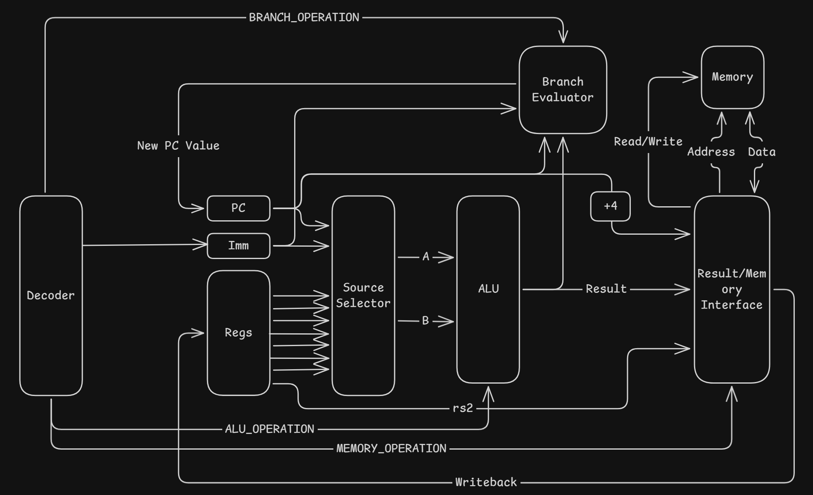
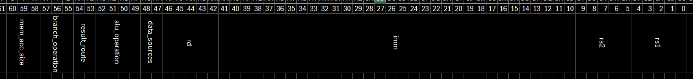
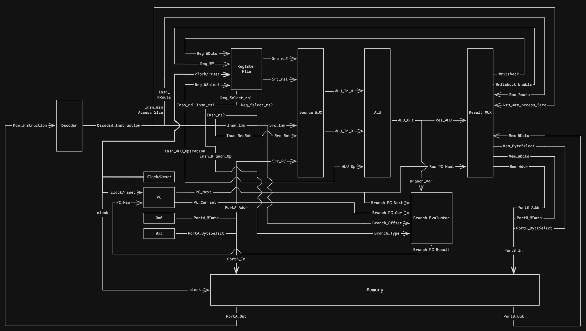

# 22.03.26
- Created repository
- Created initial draft of types
    - `regref_t` 5-bit register reference
    - `word_t` 32-bit register content
    - `raw_instruction_t` a gigantic tagged union (a struct containing a union of structs) that means I don't need to remember the offsets of different fields in a RV32 instruction. Yay!
    - `instruction_type_t` an enum for the different instruction types. Maps (roughly) to the different opcodes supported
    - `instruction_t` a struct containing decoded instruction data
- SystemVerilog has functions! And if they're entirely combinational, they are effectively the same as C-functions with `__attribute__((always_inline))`, in that they're effectively a nicer to debug function-style macro
- Made decoder + program counter (untested)
- There is an experimental LSP for systemverilog called [Verible LSP](https://github.com/chipsalliance/verible/tree/master/verible/verilog/tools/ls), that also comes with a decent linter. The default linting rules are a little annoying, so I added a linter rules file. There's also a vscode extension to make it work

# 24.03.26
- Setup cocotb for testing, since verilator has iffy support for non-synthesisable SV apparently? IDK how bad it is, but I'd much rather suffer through python than sv. :(
- cocotb uses pytest, which writes its cache wherever it pleases, so now there's a config file to stop that
- Written tests for program counter module. They pass!
- Downloaded RISC-V RV32I instruction reference from simon fraser university so I'm not always checking google :/

# 31.03.26
- made notes on funct3/funct7 decoding hardware (see [funct3 funct7 notes.md](./funct3%20funct7%20notes.md))
- vague block diagram

- started excel table of actual decoded instructions
- definitely going to have to re-do decoder
- redid `instruction_t` type, bc they were simply not _decoded enough_

# 03.04.26
- re-did decoder rtl and wrote a python version. no tests created yet.
- python enums apparently don't support having multiple names aliasing the same value, but there's a library called 'aenum' that has a custom enum class I can inherit from that fixes it! [source](https://stackoverflow.com/questions/31537316/python-enums-with-duplicate-values)
- untested alu created based on new 'ALU instructions'

# 05.04.26
- made tests for the decoder (they pass!) (after some changes to the python decoder and the sv decoder)
- writing tests for purely combinational, unclocked logic in cocotb is a little wack. The whole architecture is oriented around waiting for the next clock cycle, but there's no clock to wait for. Luckily, cocotb exposes the simulator's internal simulation steps, so that can effectively be the clock.
- made some changes to other modules that verilator compiles when executing the tests, even though those modules aren't referenced in the tests to make them compile. I cba to figure out how to configure that properly through cocotb, but I guess it'll help me later
- moved some code to a 'utils' package and moved the python decoder logic to its own file.

# 06.04.26
- wrote register file and source mux parts of diagram
- updated block diagram
- no tests for any of this yet
- fixed a bug where the python decoder and the sv decoder had different values for an enum
- fixed a compilation error where the main top module had bad signal names

# 07.04.26
- wrote so many tests today, but they all pass!
- moved more non-test stuff to utils

# 08.04.26
- was going to write ALU tests, but since I want to just test that the result is the same as python rather than calculating the results and converting to binary by hand, I wrote a `Bitint` library to make python ints behave like `[n:0] logic` since cocotb `LogicArray` does not support addition
- wrote tests for it since I don't trust that it works
- put bitints everywhere
- I probably shouldn't have spent all day on this

# 09.04.26
- wrote alu tests based on the tests for the bitint class (but not the ones testing features the alu wont have and stuff like constructors)
- the tests work? just like that?
- new program counter, bc the last one doesn't conform with the plan diagram
- mangled the tests for it so that it doesn't fail the whole suite

# 10.04.26
- wrote and tested branch evaluator block. it works

# 11.04.26
Evaluating memory architectures:
- Harvard
    - Pro: Easy to implement - create two of the same memory module, use bit 31 of memory address as 'chip select'
    - Pro: Original brief mentions specific instruction and data memory
    - Con: No self-modifying code :/
    - Con: Requires any test code created to have memory addresses changed, unless I can figure out how to get the compiler/linker to respect a custom memory map? - Does GCC even have this feature?
- Von Neumann
    - Pro: Don't need any address conversion logic, just discard bits to get desired size
    - Pro: Closer to being something vaguely realisable? (not many modifications needed to adapt to something synthesisable/programmable onto blackboard?)
    - Pro: Ibex core uses something like this I think
    - Con: Memory needs to be able to read from two locations at once
        - Ibex core uses [`prim_ram_2p`](https://github.com/lowRISC/opentitan/blob/master/hw/ip/prim_generic/rtl/prim_ram_2p.sv) from _OpenTitan_ library. This might be overkill to include just for this?
        - copied AICE1003 cpu memory (from that coursework) i wrote into project for reference on 1p memory
Von Neumann is probably better to go with for the time being. Worst case, I create two-port memory and only use one port?

# 13.04.26
- I need to add a 'memory size' part to the decoded instruction so the memory knows how much to mask
- added it to `util.py` and `types.sv`
- todo: figure out what all the bit offsets are and finish adding it to decoder.py and decoder.sv DONE

- Generated [memory test file](./tb/65536_random_bytes.bin) using [pinetools random file generator](https://pinetools.com/random-file-generator)

# 14.04.26
- Written new memory.sv and tests/
- Originally took some inspiration from program ram in AICE1002 CPU, but that was read-only. This allowed that ram to have an 'injectable' version that was easy to test, but because this memory is read/write (as it is a von-neumann architecture), that's not really doable without 'inout' ports, which seems to just add a whole lot of complexity
- Luckily, verilator + cocotb lets you manually inspect and assign values to internal variables without any kind of protection, so I can just set/read the memory directly, rather than relying on a port that mirrors it.
- Spent ages chasing down _so many_ small bugs in the python code, as usual the systemverilog was fine. It _is_ built for that, so I guess that's no suprise compared to the more complex python implementations.
- Also introduced new 4-bit type for use as byte-write select. It could have been 2-bits, but I thought it neater to map one bit to one byte rather than using an enum.
- Also, also updated the Bitint aliases to allow for them to have versions of Bitint's static methods that respected the underlying size/signed-ness of the aliased type. 

# 16.04/26
- New, more comprehensive diagram of cpu architecture including all signals
