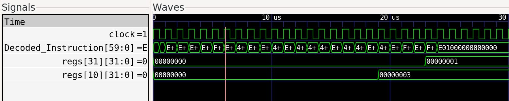

# 22.03.26
- Created repository
- Created initial draft of types
    - `regref_t` 5-bit register reference
    - `word_t` 32-bit register content
    - `raw_instruction_t` a gigantic tagged union (a struct containing a union of structs) that means I don't need to remember the offsets of different fields in a RV32 instruction. Yay!
    - `instruction_type_t` an enum for the different instruction types. Maps (roughly) to the different opcodes supported
    - `instruction_t` a struct containing decoded instruction data
- SystemVerilog has functions! And if they're entirely combinational, they are effectively the same as C-functions with `__attribute__((always_inline))`, in that they're effectively a nicer to debug function-style macro
- Made decoder + program counter (untested)
- There is an experimental LSP for systemverilog called [Verible LSP](https://github.com/chipsalliance/verible/tree/master/verible/verilog/tools/ls), that also comes with a decent linter. The default linting rules are a little annoying, so I added a linter rules file. There's also a vscode extension to make it work

# 24.03.26
- Setup cocotb for testing, since verilator has iffy support for non-synthesisable SV apparently? IDK how bad it is, but I'd much rather suffer through python than sv. :(
- cocotb uses pytest, which writes its cache wherever it pleases, so now there's a config file to stop that
- Written tests for program counter module. They pass!
- Downloaded RISC-V RV32I instruction reference from simon fraser university so I'm not always checking google :/

# 31.03.26
- made notes on funct3/funct7 decoding hardware (see [funct3 funct7 notes.md](./funct3%20funct7%20notes.md))
- vague block diagram

- started excel table of actual decoded instructions
- definitely going to have to re-do decoder
- redid `instruction_t` type, bc they were simply not _decoded enough_

# 03.04.26
- re-did decoder rtl and wrote a python version. no tests created yet.
- python enums apparently don't support having multiple names aliasing the same value, but there's a library called 'aenum' that has a custom enum class I can inherit from that fixes it! [source](https://stackoverflow.com/questions/31537316/python-enums-with-duplicate-values)
- untested alu created based on new 'ALU instructions'

# 05.04.26
- made tests for the decoder (they pass!) (after some changes to the python decoder and the sv decoder)
- writing tests for purely combinational, unclocked logic in cocotb is a little wack. The whole architecture is oriented around waiting for the next clock cycle, but there's no clock to wait for. Luckily, cocotb exposes the simulator's internal simulation steps, so that can effectively be the clock.
- made some changes to other modules that verilator compiles when executing the tests, even though those modules aren't referenced in the tests to make them compile. I cba to figure out how to configure that properly through cocotb, but I guess it'll help me later
- moved some code to a 'utils' package and moved the python decoder logic to its own file.

# 06.04.26
- wrote register file and source mux parts of diagram
- updated block diagram
- no tests for any of this yet
- fixed a bug where the python decoder and the sv decoder had different values for an enum
- fixed a compilation error where the main top module had bad signal names

# 07.04.26
- wrote so many tests today, but they all pass!
- moved more non-test stuff to utils

# 08.04.26
- was going to write ALU tests, but since I want to just test that the result is the same as python rather than calculating the results and converting to binary by hand, I wrote a `Bitint` library to make python ints behave like `[n:0] logic` since cocotb `LogicArray` does not support addition
- wrote tests for it since I don't trust that it works
- put bitints everywhere
- I probably shouldn't have spent all day on this

# 09.04.26
- wrote alu tests based on the tests for the bitint class (but not the ones testing features the alu wont have and stuff like constructors)
- the tests work? just like that?
- new program counter, bc the last one doesn't conform with the plan diagram
- mangled the tests for it so that it doesn't fail the whole suite

# 10.04.26
- wrote and tested branch evaluator block. it works

# 11.04.26
Evaluating memory architectures:
- Harvard
    - Pro: Easy to implement - create two of the same memory module, use bit 31 of memory address as 'chip select'
    - Pro: Original brief mentions specific instruction and data memory
    - Con: No self-modifying code :/
    - Con: Requires any test code created to have memory addresses changed, unless I can figure out how to get the compiler/linker to respect a custom memory map? - Does GCC even have this feature?
- Von Neumann
    - Pro: Don't need any address conversion logic, just discard bits to get desired size
    - Pro: Closer to being something vaguely realisable? (not many modifications needed to adapt to something synthesisable/programmable onto blackboard?)
    - Pro: Ibex core uses something like this I think
    - Con: Memory needs to be able to read from two locations at once
        - Ibex core uses [`prim_ram_2p`](https://github.com/lowRISC/opentitan/blob/master/hw/ip/prim_generic/rtl/prim_ram_2p.sv) from _OpenTitan_ library. This might be overkill to include just for this?
        - copied AICE1003 cpu memory (from that coursework) i wrote into project for reference on 1p memory
Von Neumann is probably better to go with for the time being. Worst case, I create two-port memory and only use one port?

# 13.04.26
- I need to add a 'memory size' part to the decoded instruction so the memory knows how much to mask
- added it to `util.py` and `types.sv`
- todo: figure out what all the bit offsets are and finish adding it to decoder.py and decoder.sv DONE


- Generated [memory test file](./tb/65536_random_bytes.bin) using [pinetools random file generator](https://pinetools.com/random-file-generator)

# 14.04.26
- Written new memory.sv and tests/
- Originally took some inspiration from program ram in AICE1002 CPU, but that was read-only. This allowed that ram to have an 'injectable' version that was easy to test, but because this memory is read/write (as it is a von-neumann architecture), that's not really doable without 'inout' ports, which seems to just add a whole lot of complexity
- Luckily, verilator + cocotb lets you manually inspect and assign values to internal variables without any kind of protection, so I can just set/read the memory directly, rather than relying on a port that mirrors it.
- Spent ages chasing down _so many_ small bugs in the python code, as usual the systemverilog was fine. It _is_ built for that, so I guess that's no suprise compared to the more complex python implementations.
- Also introduced new 4-bit type for use as byte-write select. It could have been 2-bits, but I thought it neater to map one bit to one byte rather than using an enum.
- Also, also updated the Bitint aliases to allow for them to have versions of Bitint's static methods that respected the underlying size/signed-ness of the aliased type. 

# 16.04.26
- New, more comprehensive diagram of cpu architecture including all signals

- Renamed variable names to be inline with CPU block diagram
- It turned out that in my decoding spreadsheet, that `BRANCH_ABSOLUTE` and `BRANCH_OFFSET_ALWAYS` pretty much did the same thing - that is, they set the PC to the value of the ALU's result. The only difference is what inputs the ALU gets - RS1+Imm vs PC+Imm, so I replaced them both with a new `BRANCH_ALU`
- Implemented Result Mux module and tests (passing)
- Spent far too long fixing every little piece of the new block diagram. At this point I couldn't even tell you what changes I've made since the first draft of it, other than that it's different. :/
- Implemented a **complete** top module (`rtl/RV32I.sv`). I'm very hesistant to call it that, and feel I might be jinxing it by saying that since all the component modules pass tests and I've spent an inordinate ammount of time figuring out the exact 'wiring' while making the block diagram in excalidraw, it might be likely that _it just works_. (Begone Todd Howard, there is no 16x detail to be found here!)
- It is 02:12AM on 17/04 by the time I am getting around to writing this, so it's time to go to bed ^-^

# 17.04.26
- installed riscv toolchain from lab 1 because I don't want to do a 6.5GB download of sourcecode just to build the compiler from scratch.
- wrote very simple test script - `c/add/main.c` which just adds 1 to 2 and returns the result, but that should be complex enough to test the build system to check it is actually executing code when that gets written
- I know that to get the code in the right place, I'll need to use a linker script, but idk how they work
- [useful linker script tutorial](https://mcyoung.xyz/2021/06/01/linker-script/#fnref:13)
- [example linker scripts for embedded](https://medium.com/@mkklyci/an-introduction-to-linker-files-crafting-your-own-for-embedded-projects-60ad17193229)
- set RAM size to be 16MB rather than the 64KB I've been keeping it at so that my test program can be a bit bigger (if needed)
- Wrote a basic linker script - since I'm not actually producing an ELF, I'm not sure that everything I've included is ne
necessary, but I've read enough tutorials, and almost everything has a bootloader that reads elf headers, but I cba to make
one.
- apparently it's _undefined behaviour_ for C to do anything if the .bss and .data sections haven't been initialised. so I have to write that in assembly :(. At least it's small.
- Also, while it's cool that linker scripts can inject symbols back up the compilation process, I absolutely hate it
- I don't want to wait for ages if I put in a large timeout, so I need to have a way I can detect from cocotb to tell the
test harness that the code is done, so that it doesn't just busy wait for the rest of the time
- Either:
    - Reserve a register as a 'I am done register' and continually check if it has some specific value
        - Hope that the compiler never tries to use it and accidentally writes the value to kill the CPU then and there
    - Reserve a memory address to write to for the same purpose, and when the value there equals a kill value, die.
        - Because the file created after linking isn't necessarily the size of the memory, I can force the linker to
        leave enough space for the memory, so that at the very least it won't exit literally immediately after loading.
        I just need to make sure that I do actually have memory there though to write to.
    - Reserving a register is simpler to observe in gtkwave, so went with that one. Plus, unless I'm using a truly monstrous ammount of variables, there's no way that GCC will try to use the _sixth_ temporary right?
    - I am aware that this is definitely going to come back and bite me.
- Looked [here](https://www.cs.colby.edu/maxwell/courses/tutorials/maketutor/) for infromation on how to make (hah!) a simple makefile to invoke literally _every single stage_ of the compilation pipeline individually
- `-ffreestanding`, `-nostdlib` and `-nostartfiles` seem to be the magic combination of flags to get the compiler to literally compile _only_ my code and not try anything funny with pulling in OS-specific dependencies that I don't have access to. There might be even more flags, but idk
- Wrote python `run_program.py` script to use cocotb to launch, load and run a .bin program on the rv32i core. It turns out that the tests actually run in a different environment to the main script, so it doesn't have any access to variables defined there. So the best I could figure out was to set an environment variable, and since linux processes are forked, the new python instances running the tests _should_ inherit them, and I can then read them back. Though that's as a string, so most of `argparse`'s hard work is for naught.

**IT WORKS!**


# 18.04.26
- Last night, I made a new test `strings` which has a static string 'Hello, World!' to check that the linking of the `.rodata` section worked (because `const char` literals in c are always placed into rodata), but running it had some unexpected results
- Added a memory dump feature to see what it was doing. This way, I can dump the contents of ram to a .bin file (if it is small, large rams take a while to dump) after the program terminates to see what happens
- It turned out that data in the `.text` section was being zeroed during execution, which while possible (I have no memory protection of any kind), is not correct for standard C behaviour. This turned out to be because I had set the `PortA_WriteSelect` to `0xf` when it should have been `0x0`. This wrote the `PortA_WData` (always zero) to the memory location of the PC (`PortA_Addr`), overwriting instructions as they were executed, which broke every single loop which is not good. This came from copying my block diagram which had that mistake in it. The code and block diagram have been updated
- Afterwards, I encountered a bug where the loop to set the `.bss` section was never finishing because the start was very small and the end was at the correct place, causing the simulation to time out as it tried to clear almost all of the data in memory. This was because the PC module was set to always increment the PC, no matter if it's just come out of reset or not. This meant that the first instruction executed was instruction 4 (or 8, I'm not quite sure). Either way, this mangled the writing of the `__bss_start` symbol, which caused this error. I fixed this by simply moving the PC advance to a new else clause on the reset check.

# 27.04.26
- Wrote `test` c program that tests all the supported instructions
    - Verfied that it uses all the supported instructions by using the following command:
    ```bash
    riscv32-unknown-elf-objdump -d -s -M no-aliases program.elf | grep -P "\s[\dabcdef]*:" | grep -P "\s{4}([a-z]+)" -o | awk '{$1=$1};1' | sort | uniq > used_instructions.txt
    ```
    - Then, I manually sorted through the list of all the used instructions and checked against my table of RV32I instructions that I support
- Test program shows that all 42 tests pass - All instructions operate as expected
- Integrated `test` program into testbench suite
- Fixed diagram issue where RS1 and RS2 out of the register file were swapped